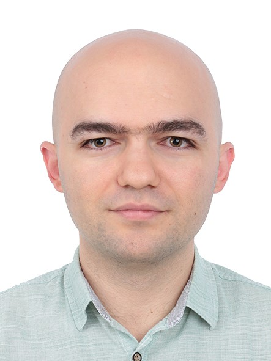
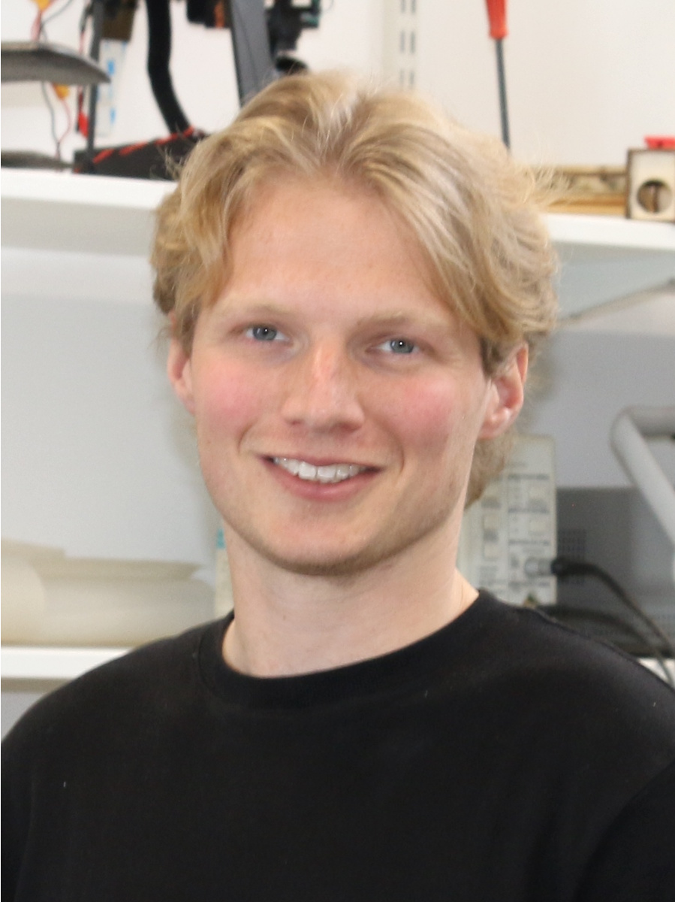
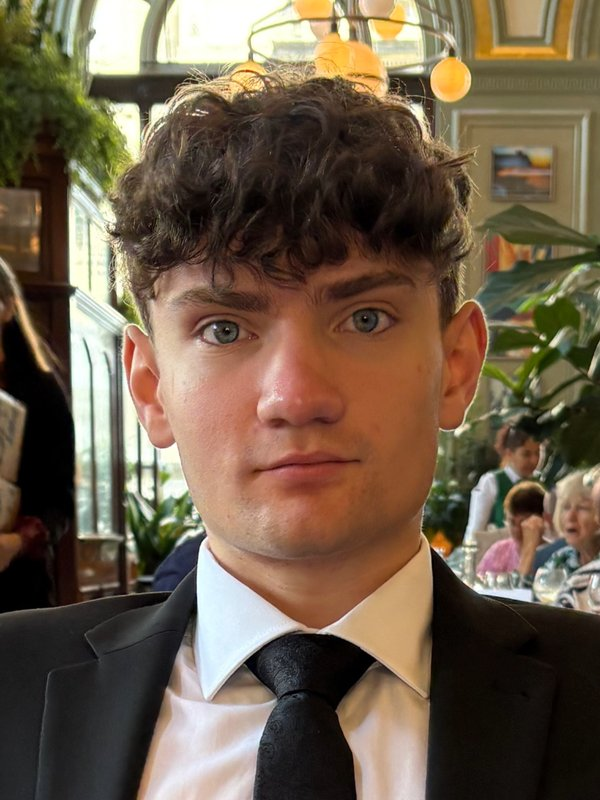
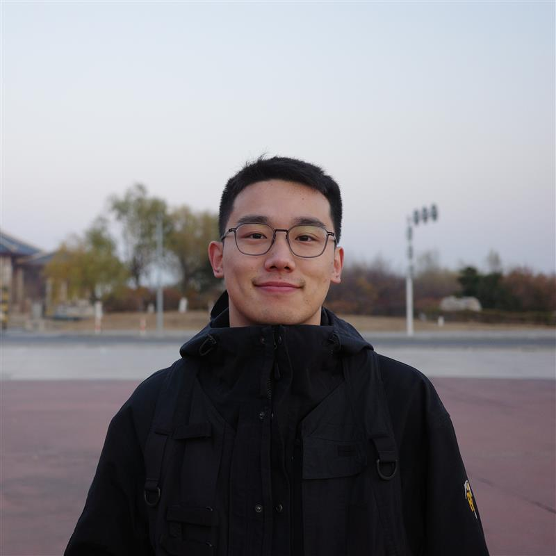
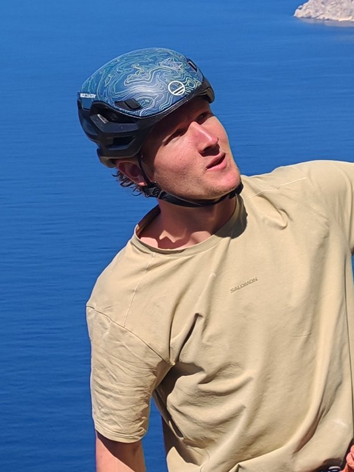
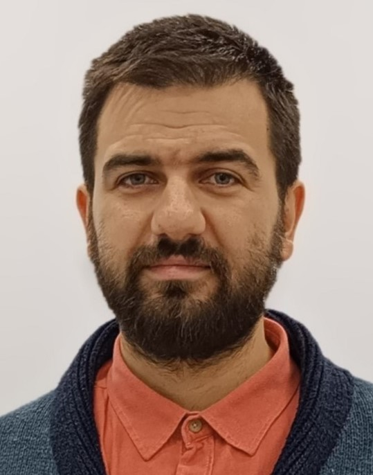

<!-- Card layout: every photo shows at 150x200 (cropped to fill), and each card's icons sit at the
     bottom so they line up across a row even when one card has an extra line of text. -->

  
  
<strong>Dr. Bahadir Kocer</strong>

  
<em>Lecturer</em>

  
Aerial Robotics

  

    
    
    
  

  
  
<strong>Dr. Ahmet Fevzi Bozkurt</strong>

  
<em>Visiting Research Fellow</em>

  
Soft Robotics for UAVs

  

    
    
    
  

<!-- Researchers -->

  
  
<strong>Haichuan Li</strong>

  
<em>PhD Student</em>

  
Perching Mechanism

  

    
    
    
  

  
  
<strong>Ziang Zhao</strong>

  
<em>PhD Student</em>

  
Minimal Invasive Design

  

    
    
    
  

  
  
<strong>Ziniu Wu</strong>

  
<em>PhD Student</em>

  
Robot Learning

  

    
    
    
  

  
  
<strong>Alex Dunnett</strong>

  
<em>PhD Student</em>

  
Perception and Guidance

  

    
    
    
  

  
  
<strong>Jianduo Chai</strong>

  
<em>PhD Student</em>

  
Trajectory Prediction

  

    
    
    
  

  
  
<strong>Luke Wainwright</strong>

  
<em>PhD Student</em>

  
Safe Autonomous Flight

  

    
    
    
  

  
  
<strong>Ke Tian</strong>

  
<em>PhD Student</em>

  
Path Planning

  

    
    
    
  

  
  
<strong>Jelly Liu</strong>

  
<em>PhD Student</em>

  
Soft Aerial Robotics

  

    
    
    
  

  
  
<strong>Jack Forrest</strong>

  
<em>PhD Student</em>

  
Learning-based Control

  

    
    
  

  
  
<strong>Šimon Prokop</strong>

  
<em>Research Intern</em>

  
Visual Robot Navigation

  

    
    
    
  

<!-- Alumni cards: name, role and affiliation, year, research topic, next position, then links. -->
<h2 style="margin: 40px 0 20px;">Postdoc Alumni</h2>

  
  
<strong>Dr. Ali Karasahin</strong>

  
<em>Visiting Research Fellow</em>

  
Learning-based Control

  
Next position:

  
Assistant Professor at Necmettin Erbakan University

  

    
    
    
  

<h2 style="margin: 40px 0 20px;">MSc Alumni</h2>

  
  
<strong>Kangle Yuan</strong>

  
<em>MSc Student at Imperial</em>

  
2023–24

  
Bio-inspired Drone Perching

  
Next position:

  
PhD Student in MAVLab, TU&nbsp;Delft

  

    
  

  
  
<strong>Javier Paez Franco</strong>

  
<em>MSc Student at Imperial</em>

  
2024–25

  
Continual Non-stationary RL

  
Next position:

  
PhD Candidate at ARL, NTNU

  

    
    
  

  
  
<strong>Pongporn Supa</strong>

  
<em>MSc Student at Bristol</em>

  
2024–25

  
Soft Aerial Robotics

  
Next position:

  
PhD Student in Max Planck Institute &amp; University of Stuttgart

  

    
    
  

<h2 style="margin: 40px 0 20px;">Intern Alumni</h2>

  
  
<strong>Parth Potdar</strong>

  
<em>Research Intern</em>

  
2024–25

  
Bio-inspired Drone Perching

  
Next position:

  
Robotics Software and Systems Engineer at Oxford&nbsp;Robotics&nbsp;Institute, University&nbsp;of&nbsp;Oxford

  

    
    
    
  

